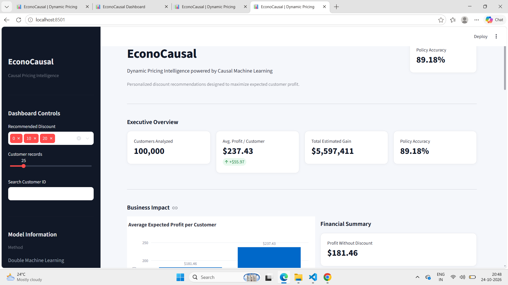
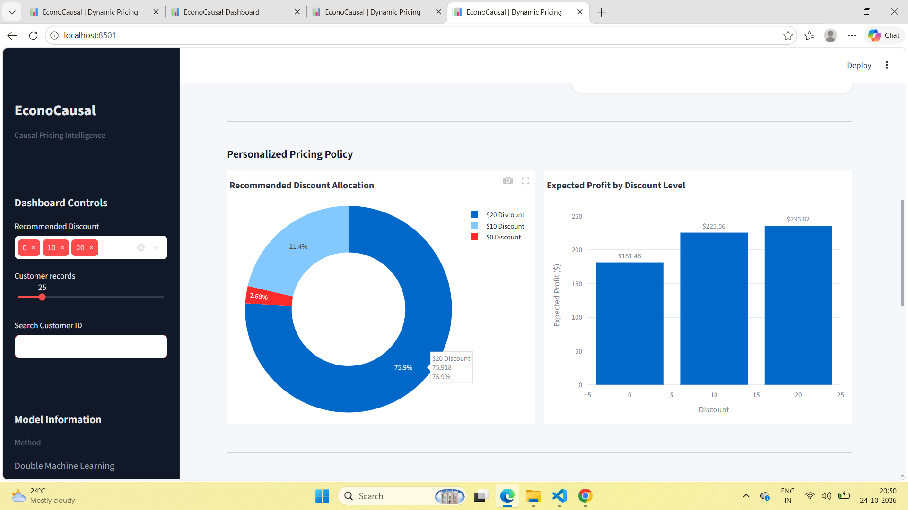
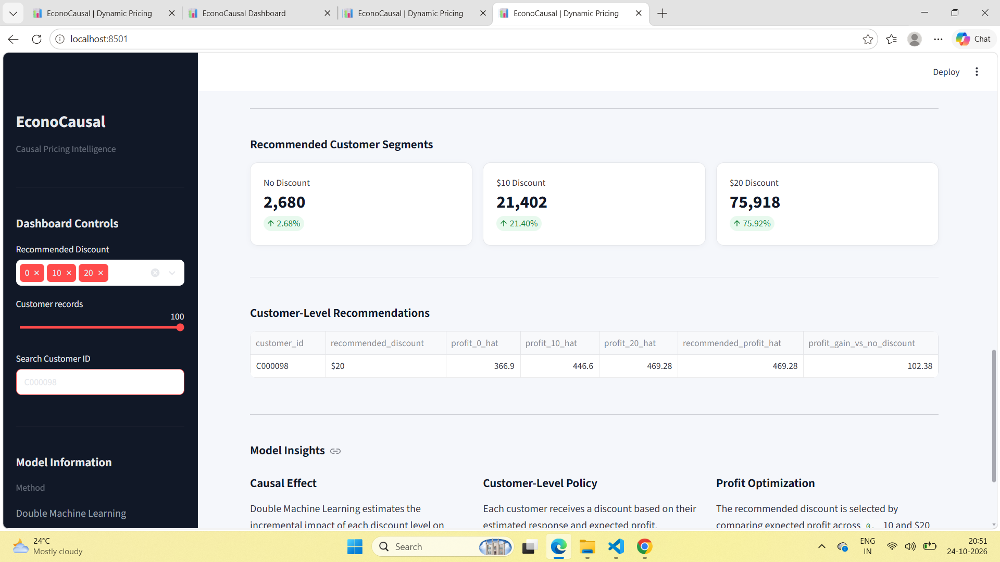

# EconoCausal — Sanjana Contributions

## Overview

This document summarizes my contributions to the **EconoCausal** project, a Dynamic Pricing system based on **Causal Machine Learning and Double Machine Learning (DML)**.

My work focused on building the improved causal retail dataset, implementing causal effect estimation, developing a personalized pricing policy based on expected profit, validating the policy against known ground truth, and building the Streamlit dashboard.

---

## Dashboard Preview

### Executive Overview



### Personalized Pricing Policy



### Customer-Level Recommendations



---

## My Contributions

### 1. Improved Synthetic Causal Retail Dataset

Created an improved synthetic dataset containing:

- **100,000 customers**
- **12 pre-treatment customer features**
- Three treatment levels:
  - `$0` discount
  - `$10` discount
  - `$20` discount
- Binary purchase outcome
- Confounded treatment assignment
- Heterogeneous treatment effects
- Customer-level economic/profit calculations

Main dataset:

```text
data/causal_retail_data.csv
```

Ground-truth dataset:

```text
data/causal_retail_ground_truth.csv
```

The original dataset was preserved and was not overwritten.

---

## 2. Causal Treatment Assignment

The discount assignment was designed so that customer characteristics influence which discount a customer receives.

Important confounding variables include:

- Loyalty score
- Product interest score
- Days since last purchase
- Email engagement
- Previous discount usage
- Cart additions

This creates a more realistic causal inference setting instead of randomly assigning discounts.

---

## 3. Causal DAG with DoWhy

Built a causal graph using **DoWhy** to represent relationships between customer characteristics, discount treatment, and purchase outcome.

The identified backdoor adjustment variables included:

- `cart_additions`
- `previous_discount_usage`
- `product_interest_score`
- `days_since_last_purchase`
- `email_engagement`
- `loyalty_score`

---

## 4. Double Machine Learning with EconML

Implemented **Double Machine Learning (DML)** using EconML.

The analysis estimates how different discount treatments change the probability of purchase.

Pairwise treatment effects were estimated for:

- `$10 vs $0`
- `$20 vs $0`
- `$20 vs $10`

Random Forest models were used as the base estimators.

### Estimated Mean Effects

| Treatment Comparison | Estimated Effect |
|---|---:|
| $10 vs $0 | 0.1493 |
| $20 vs $0 | 0.2058 |
| $20 vs $10 | 0.0580 |

The results show that the treatment effect varies across customers rather than being identical for everyone.

---

## 5. Personalized Pricing Policy

Instead of assigning the same discount to every customer, the system estimates expected profit under each available discount.

For every customer:

```text
Expected Profit($0)
Expected Profit($10)
Expected Profit($20)
```

The system recommends the discount with the highest estimated expected profit.

### Recommended Policy Distribution

| Recommended Discount | Customers |
|---|---:|
| $0 | 2,680 |
| $10 | 21,402 |
| $20 | 75,918 |

---

## 6. Policy Validation

The learned pricing policy was compared against the hidden ground-truth optimal policy generated during dataset creation.

### Policy Accuracy

**89.18%**

This indicates that the learned policy correctly identified the optimal discount for approximately 89 out of every 100 customers in the synthetic validation setting.

---

## 7. Profit Optimization

The pricing policy incorporates an economic objective rather than optimizing purchase probability alone.

A **30% margin rate** was used to estimate expected profit after accounting for the discount.

### Results

| Metric | Result |
|---|---:|
| Average profit without discount | $181.46 |
| Average profit with personalized policy | $237.43 |
| Average profit gain per customer | $55.97 |
| Total estimated profit gain | ~$5.60M |

The personalized policy therefore estimates a significant improvement over giving customers no discount.

---

## 8. Effect Validation

Estimated treatment effects were compared against the known synthetic ground truth.

| Treatment Comparison | MAE | RMSE |
|---|---:|---:|
| $10 vs $0 | 0.0368 | 0.0455 |
| $20 vs $0 | 0.0781 | 0.0962 |
| $20 vs $10 | 0.0417 | 0.0513 |

These metrics provide a quantitative check of how closely the DML estimates recover the known treatment effects.

---

## 9. Streamlit Dashboard

Developed a professional **Streamlit + Plotly dashboard** for presenting the causal pricing results.

Dashboard features include:

- Policy accuracy KPI
- Customer count
- Average profit metrics
- Incremental profit
- Recommended discount distribution
- Expected profit by discount level
- Customer-level recommendations
- Customer ID search
- Discount filtering
- Customer record controls
- Model information
- Business impact summary

Dashboard file:

```text
src/dashboard.py
```

### Dashboard Technologies

- Python
- Streamlit
- Plotly
- Pandas

---

## 10. Project Files Added/Updated

The main files associated with this work include:

```text
data/
├── causal_retail_data.csv
├── causal_retail_ground_truth.csv
├── causal_model_results.csv
├── causal_policy_results.csv
└── causal_modeling_summary.csv

notebooks/
├── 02_causal_modeling.ipynb
└── 03_generate_improved_dataset.ipynb

src/
└── dashboard.py

screenshots/
├── dashboard_overview.png
├── pricing_policy.png
└── customer_recommendations.png
```

---

## 11. Technology Stack

- **Python**
- **Pandas**
- **NumPy**
- **Scikit-learn**
- **EconML**
- **DoWhy**
- **SciPy**
- **Plotly**
- **Streamlit**
- **Jupyter Notebook**

---

## 12. Key Outcome

The implemented system demonstrates an end-to-end causal pricing workflow:

```text
Customer Data
      ↓
Causal DAG
      ↓
Confounder Identification
      ↓
Double Machine Learning
      ↓
Individual Treatment Effects
      ↓
Expected Profit Estimation
      ↓
Personalized Discount Recommendation
      ↓
Business Dashboard
```

The main objective is to move beyond simply predicting **who will purchase** and instead estimate **how a discount changes purchase behavior and which discount is economically preferable for each customer**.

---

## Disclaimer

The dataset used for this implementation is synthetic. The reported policy accuracy, treatment effects, and profit estimates are therefore validation results within the constructed simulation and should not be interpreted as real-world business results.

## Current Project Status

The project has been completed with the causal modeling pipeline, personalized pricing policy, model validation, and Streamlit dashboard. The final implementation includes customer-level pricing recommendations and business impact analysis based on estimated causal effects.

## Testing

The project includes automated data validation tests to verify the quality and consistency of the causal retail dataset before model development.

The validation checks include:

- Dataset shape and expected number of columns
- Required feature columns
- Missing values
- Age range
- Loyalty score range
- Product interest score range
- Valid discount values
- Valid purchase values

To run the validation tests:

```bash
python -m pytest tests/test_project_validation.py
```

All validation checks should pass before proceeding with further model development or analysis.

